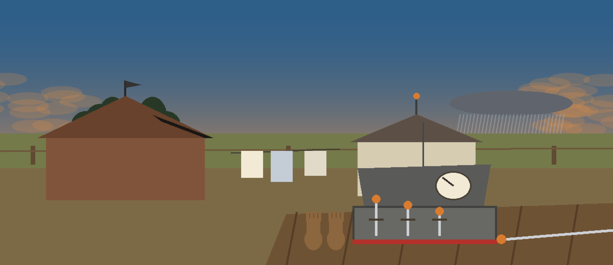
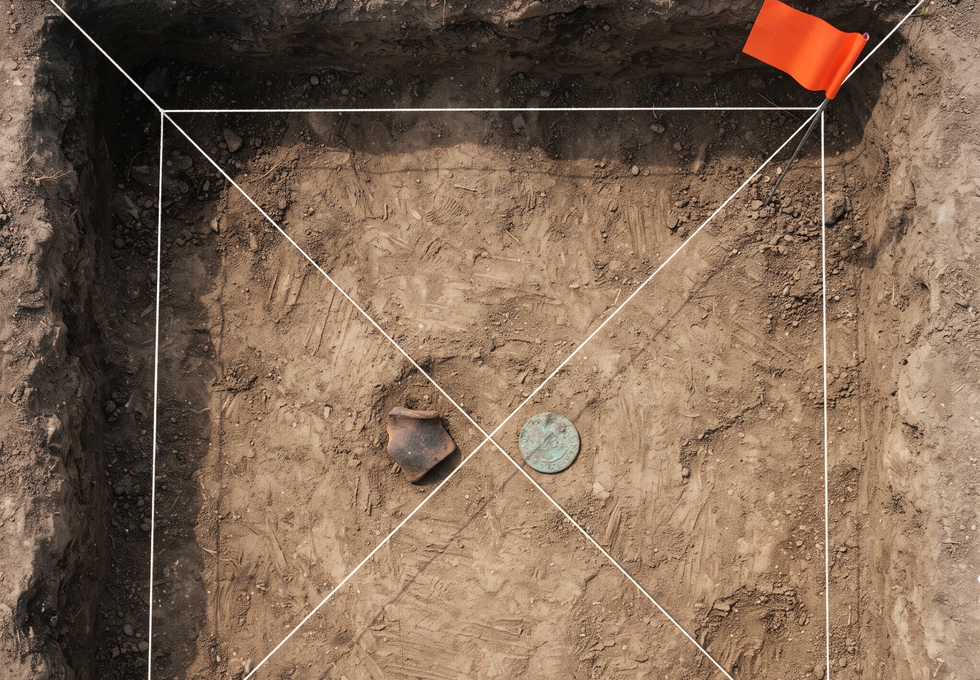
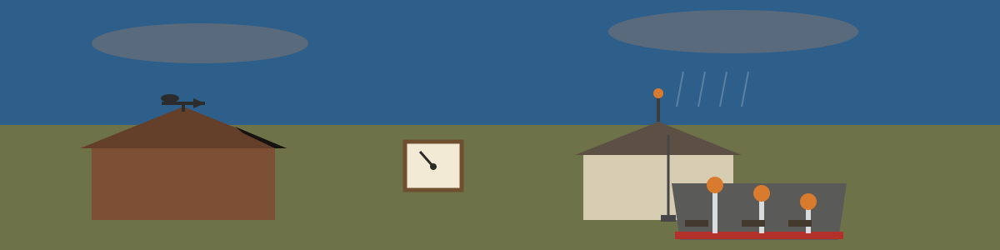

# analyze-forensic-timeline-generator

Generates a timeline of system events from log files to reconstruct attack sequences. Supports different timestamp formats, focusing on automated data analysis and reporting

## Install
`git clone https://github.com/ShadowGuardAI/analyze-forensic-timeline-generator`

## Usage
`./analyze-forensic-timeline-generator [params]`

## Parameters
- `-o`: No description provided
- `-tsf`: No description provided
- `-k`: Keywords to filter for in log entries.
- `-v`: Enable verbose output for debugging.
- `--no-header`: Omit the CSV header in the output file.

Exit status: the tool exits 1 if the output CSV cannot be written, or if any named log file could not be read. Exit 0 means the timeline was written and every named log file was read.

Note: an earlier `-p` / `--priority` option was removed in 2026. It accepted a minimum priority but never filtered anything, because the log lines this tool parses carry no priority field. Use `-k` to filter by keyword instead.

## License
Copyright (c) ShadowGuardAI

> Storm note: -o and -tsf are both listed with no description provided, and this page does not guess at either. A second storm note belongs to the retired model: the removed -p and --priority option never filtered anything, because the log lines this tool parses carry no priority field, and -k is the filter to use in its place.
