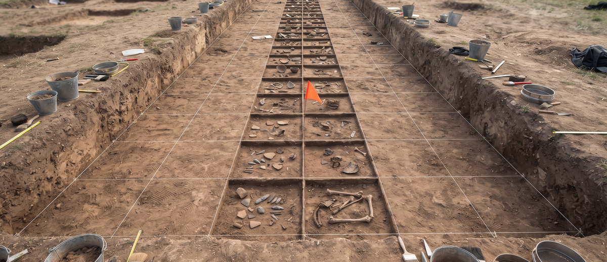

# analyze-forensic-timeline-generator
Generates a timeline of system events from log files to reconstruct attack sequences. Supports different timestamp formats. - Focused on Data analysis and reporting

## Install
`git clone https://github.com/ShadowGuardAI/analyze-forensic-timeline-generator`

## Usage
`./analyze-forensic-timeline-generator [params]`

## Parameters
- `-o`: No description provided
- `-tsf`: No description provided
- `-k`: Keywords to filter for in log entries.
- `-v`: Enable verbose output for debugging.
- `--no-header`: Omit the CSV header in the output file.

Note: an earlier `-p` / `--priority` option was removed in 2026. It accepted a minimum priority but never filtered anything, because the log lines this tool parses carry no priority field. Use `-k` to filter by keyword instead.

## License
Copyright (c) ShadowGuardAI
